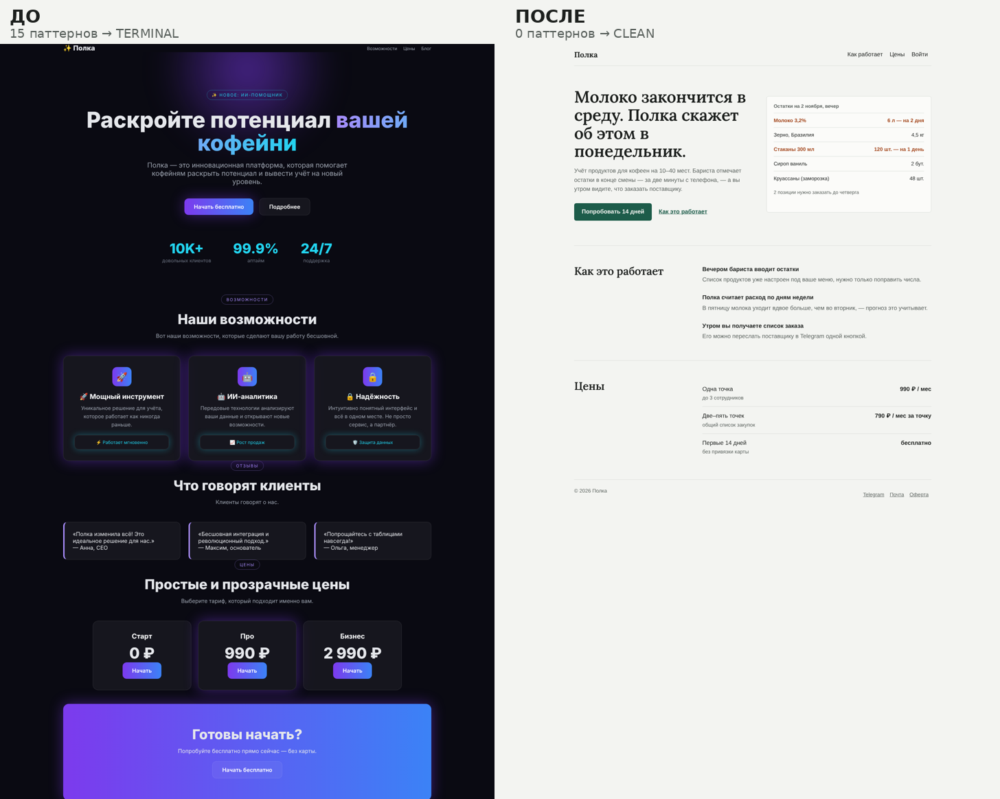

# neuroslop-cleaner

Скилл для Claude: распознать «нейрослоп» — типовой вид, по которому сразу видно, что картинку, игровой экран, сайт или приложение сделала нейросеть, — и вычистить его.



## Что делает

1. **Определяет, что перед ним** — сгенерированная картинка, настоящий скриншот интерфейса, сайт или веб-приложение, нативное мобильное приложение.
2. **Меряет** — цветовой сдвиг картинки (`cast.py`) или страницу целиком на трёх ширинах (`webslop.py`).
3. **Осматривает по таблицам признаков** — цвет и свет, края, композиция, перебор декора, повторы, мусорные значки, шрифт, иллюстрация, текст (включая подмену кириллических букв), арифметика, состояния; для сайтов — шаблон страницы, дефолты Tailwind/shadcn, штампы в текстах, адаптив, зоны нажатия, «вторая волна» штампов; для приложений — правила iOS и Android.
4. **Даёт отчёт**: что убрать, что уже чисто, что важно не про слоп.
5. **Сразу даёт готовые промпты**: на правку картинки, на генерацию с нуля (в том числе по референсу), направление дизайна для генераторов кода (Claude, v0, Lovable, Cursor).
6. **Проверяет результат** «было → стало»: ✅ исправлено, ❌ проигнорировано, ⚠️ регрессии — с правилом остановки.

## Примеры

- [`examples/web`](examples/web) — лендинг до и после: 15 паттернов (TERMINAL) → 0 (CLEAN), скролл вбок и кнопки 10×15 px на телефоне → без скролла и от 44 px.
- [`examples/game`](examples/game) — игровой экран и три прохода через Gemini с промптами, что исправилось, что нет и что сломалось по дороге.

## Установка

- **Claude (claude.ai):** загрузи `SKILL.md` как скилл. Скрипт замера цвета встроен в сам `SKILL.md`; `webslop.py` скилл скачает из этого репозитория, когда понадобится.
- **Claude Code:** скопируй папку целиком в `~/.claude/skills/neuroslop-cleaner/`.

## Скрипты

```bash
pip install pillow numpy playwright && playwright install chromium

# картинки
python3 scripts/cast.py measure img.png                 # замер b*/a* светлых мест и кадра
python3 scripts/cast.py fix in.png out.png              # убрать жёлтый сдвиг (--target 6 — оставить лёгкую сепию, --a — розовый/зелёный)
python3 scripts/cast.py sheet sheet.jpg a.png b.png     # контактный лист для серии

# сайты и веб-приложения
python3 scripts/webslop.py audit https://site.ru --out shots   # скриншоты 390/768/1440, скролл вбок, зоны нажатия, паттерны, штампы
python3 scripts/webslop.py scan ./src                          # поиск по исходникам
```

Шкала b*: |b*| ≤ 3 — нейтрально; +4…+8 — тёплый сдвиг; > +8 — явная желтизна; < −3 — холодный. Полосы `webslop.py`: CLEAN 0–1 паттерн, MILD 2–3, SLOPPY 4–6, TERMINAL 7+. Это сигналы, а не приговор — скриншоты всё равно смотрят глазами.

## Структура

```
SKILL.md              инструкция скилла (со встроенной копией cast.py)
scripts/cast.py       замер и правка цветового сдвига
scripts/webslop.py    аудит сайта на трёх ширинах и поиск по исходникам
examples/             примеры до/после с отчётами и промптами
```

`scripts/cast.py` и копия внутри `SKILL.md` должны совпадать — при правке скрипта обнови обе.

## Источники признаков для сайтов

Каталоги паттернов [pixelslop](https://cdn.jsdelivr.net/npm/pixelslop@0.3.8/dist/skill/resources/ai-slop-patterns.md) и [impeccable](https://www.mintlify.com/pbakaus/impeccable/concepts/anti-patterns), разборы [почему все AI-сайты фиолетовые](https://dev.to/alanwest/why-every-ai-built-website-looks-the-same-blame-tailwinds-indigo-500-3h2p), [«второй волны» штампов](https://capitalandcompute.net/blog/fix-ai-slop-design/), [признаков vibe-coded UI](https://www.thefountaininstitute.com/blog/signs-vibe-coded-ui), [шрифтов и градиентов](https://www.925studios.co/blog/ai-slop-design-tells), [нативности iOS-приложений](https://vp0.com/blogs/make-ai-app-look-native-ios), [штампов в текстах](https://dev1.letteros.com/en/blog/shtampy-nejrosetej-v-rassylkah); размеры зон нажатия — [WCAG 2.2, Apple HIG, Material](https://frontendchecklist.io/rules/accessibility/touch-targets).
