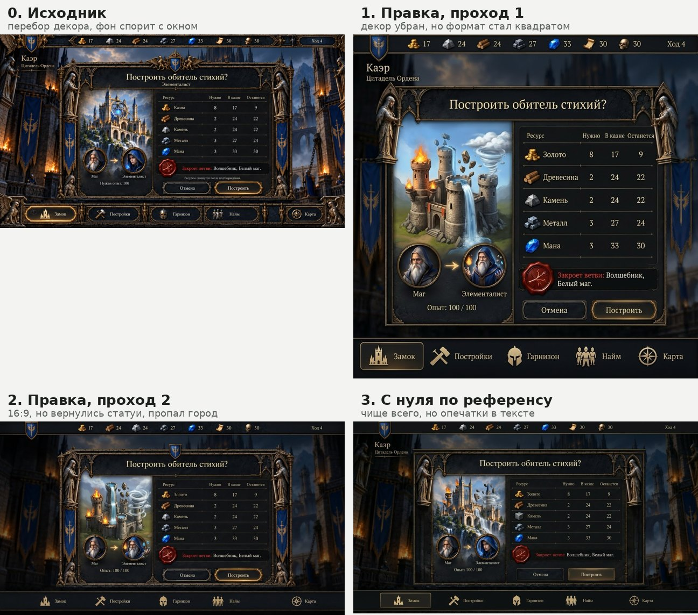

# Игровой экран: три прохода через генератор

Концепт экрана стратегии «Построить обитель стихий?», сгенерированный нейросетью, и три попытки вычистить его в Gemini по промптам скилла.



| версия | файл | что получилось |
|---|---|---|
| 0. Исходник | `0-original.jpg` | Перебор декора (около 16 статуй, грифонов и гаргулий, 6 одинаковых знамён); фон такой же яркий, как окно; «обитель стихий» без стихий; маг превращается в девушку; камень и металл — одинаковые серые слитки; «Казна» в колонке «В казне»; ресурсы в разном порядке. Цифры при этом сходятся |
| 1. Правка, проход 1 | `1-edit-pass1.jpg` | ✅ декор убран, фон затемнён, один персонаж, единые иконки, тексты поправлены. ❌ формат 16:9 стал квадратом, порядок ресурсов и камень не исправлены. ⚠️ иллюстрация стала мультяшной |
| 2. Правка, проход 2 | `2-edit-pass2.jpg` | ✅ 16:9, порядок, предупреждение в одну строку. ❌ камень, стиль иллюстрации. ⚠️ регрессии: вернулись статуи и щит, пропала подпись города, пропало активное состояние «Замок», рука за рамкой портрета |
| 3. С нуля по референсу | `3-from-scratch.jpg` | Чище всего по композиции и стилю, камень наконец матовый. ⚠️ опечатки «Нужпо», «В казпе», «Камель», «Элемєнталист»; элементалист снова девушка — референс «протёк»; порядок ресурсов снова сбит |

Замер оттенка (`measure.txt`): b* огней и золота 19,2 → 6,7 → 11,3 → 9,9. Экран тёмный (светлого меньше 1%), поэтому автоправку цвета скилл не применяет — замер нужен, чтобы видеть, не «засветилась» ли картинка снова.

## Выводы, которые вошли в скилл

- Формат задавать в настройках генератора, а не только в промпте.
- Больше ~10 правок за раз — генератор начинает терять пункты; дели на проходы.
- Элемент, проигнорированный два прохода подряд, — в отдельный ассет.
- Если регрессий больше, чем исправлений, — перестать гонять весь экран.
- Кириллицу читать по буквам; для экранов с таблицами — подложка без текста и настоящий шрифт сверху.
- В генерации по референсу явно запрещать то, что на исходнике было не так.

## Промпты

### Проход 1 — правка

```
Edit this game UI screenshot. Keep the overall layout, the dialog position and size, the color palette (dark iron, muted gold, deep blue) and ALL Russian text and numbers exactly as they are, except for the changes listed below. Render Cyrillic exactly as written, do not render quotation marks.

BACKGROUND
1. Darken the castle background behind the dialog by about 65% and blur it slightly, so the dialog is clearly the main element.
2. Keep only two blue banners in the background, remove the rest.

DECOR (remove clutter)
3. Remove all statues and figurines between the buttons of the bottom navigation bar.
4. Remove the griffin and gargoyle sculptures in all four screen corners.
5. Remove the two hooded statues at the bottom corners of the dialog. Keep only the two statues at the top corners of the dialog.
6. In the top bar, remove the decorative crossbow-griffin ornament and the small knight figure between the skull counter and the turn counter.
7. Make the top bar and the bottom navigation bar simple: dark iron with one thin muted gold edge line, no filigree, no ornaments.

ILLUSTRATION (left panel)
8. Replace the castle illustration with an elemental sanctuary: one compact tower complex where each of four towers shows its element clearly: fire braziers on one, a water cascade from another, floating rocks around the third, swirling wind and clouds around the fourth. No armillary sphere, no glowing blue orb.
9. Portraits: show the SAME old bearded wizard in both circles. Left: grey robe, labeled Маг. Right: the same man in a deep blue robe with a faint elemental aura around his hands (small flame, water drops, pebbles), labeled Элементалист.

ICONS
10. Stone resource icon (row Камень and in the top bar): a rough grey hewn stone block, matte, no metallic shine, clearly different from the metal ingots.
11. Bottom navigation icons: all in one style, flat muted-gold silhouettes like the castle icon on the Замок button: hammer, helmet, three soldiers, compass.

TEXT CHANGES
12. In the table, rename the first resource from Казна to Золото.
13. In the top bar, order the resources like the table: gold 17, wood 24, stone 24, metal 27, mana 33, then scroll 30, skull 30.
14. Replace Нужен опыт: 100 with Опыт: 100 / 100.
15. Remove the line Ресурсы спишутся после подтверждения.
16. Remove the small subtitle Элементалист under the dialog title.

Avoid: extra glow, lens flares, sparkles, stronger orange-teal grading, new text or labels that are not listed here. Keep the numbers in the table unchanged: 8/17/9, 2/24/22, 2/24/22, 3/27/24, 3/33/30.
```

### Проход 2 — только оставшееся

```
Edit this game UI screenshot. Output aspect ratio 16:9 (1280x720), widen the layout horizontally, do not crop. Keep everything else exactly as it is, including all Russian text and numbers. Do not render quotation marks.

1. Top bar resource order, left to right: gold 17, wood 24, stone 24, metal 27, mana 33, scroll 30, skull 30.
2. Stone icon (top bar and table row Камень): rough grey hewn stone block with chipped edges and visible stone texture, completely matte, no metallic shine, no silver highlights. It must look clearly different from the metal ingots.
3. Left illustration: redraw in the same painterly dark-fantasy style and muted lighting as the rest of the screen, not cartoon, not casual mobile game style. A tall, grand gothic sanctuary of the elements with four towers: fire braziers, a water cascade, floating rocks, swirling wind. Muted colors, dusk light.
4. Make the warning box wider so Закроет ветви: Волшебник, Белый маг. fits on one line.
5. Give the table header Останется enough space from the right frame edge.

Avoid: glow, lens flares, sparkles, new text or labels.
```

### С нуля по референсу

Исходник прикреплён как референс, формат 16:9 выставлен в настройках.

```
Use the attached screenshot as a reference for layout, composition, palette and general style. Generate a NEW clean version of this game screen, 16:9, 1280x720. Do not copy its ornaments and decorations; follow only the description below. Painterly dark-fantasy style, realistic proportions, muted colors: dark iron, aged muted gold, deep blue. Neutral dusk lighting, no orange-teal grading. Render all Cyrillic text exactly as written, no quotation marks, no extra text.

KEEP FROM THE REFERENCE
The same positions: top resource bar, city name at top left, centered confirmation dialog with an illustration on the left and a resource table on the right, bottom navigation bar with five items.

BACKGROUND
The same citadel, darkened by about 65% and slightly blurred so the dialog is clearly the main element. Only two blue banners visible.

TOP BAR (simple dark iron strip, one thin muted gold edge line, no ornaments, no figurines)
Left: small blue shield with winged sword; under it on the background: Каэр (larger) and Цитадель Ордена (smaller).
Resources left to right: gold coins 17, wood logs 24, grey stone block 24, metal ingots 27, blue mana crystal 33, parchment scroll 30, skull 30.
Right: Ход 4.

DIALOG
Frame: dark iron with muted gold edges and gothic arches on top. Exactly two knight statues, one at each top corner. No statues at the bottom corners, no shield or griffins on top of the frame.
Title: Построить обитель стихий? (no subtitle under it)
Left panel: a tall gothic sanctuary of the four elements on a cliff, in the same painterly style, not cartoon: fire braziers on one tower, a water cascade from another, floating rocks around the third, swirling wind around the fourth. No armillary sphere, no glowing orb.
Below: two round gold-framed portraits with an arrow between them, both the SAME old bearded wizard: left in a grey hooded robe, caption Маг; right in a deep blue robe with a faint elemental aura kept fully inside the circle, caption Элементалист. Under them: Опыт: 100 / 100.
Right panel table, header: Ресурс, Нужно, В казне, Останется. Rows:
gold coins, Золото, 8, 17, 9
wood logs, Древесина, 2, 24, 22
grey stone block, Камень, 2, 24, 22
metal ingots, Металл, 3, 27, 24
blue mana crystal, Мана, 3, 33, 30
Below the table: a wide box with a red wax seal and one line: Закроет ветви: Волшебник, Белый маг. (Закроет ветви: in muted red, the rest in light cream). No other text under it.
Buttons: Отмена (dark, thin iron frame) and Построить (muted gold frame, slightly brighter).

BOTTOM NAVIGATION (simple dark iron strip, no ornaments, no statues between items)
Five evenly spaced items, flat muted-gold silhouette icons with labels: castle Замок, hammer Постройки, helmet Гарнизон, three soldiers Найм, compass Карта. Замок is active, highlighted with a muted gold frame.

ICONS
Stone: rough grey hewn block with chipped edges and granite texture, completely matte, no metallic shine, clearly different from the metal ingots.

AVOID
Glow, lens flares, sparkles, light bloom, gargoyles, griffins, extra statues, filigree on every frame, cartoon or casual mobile style, extra text, changing any numbers.
```
