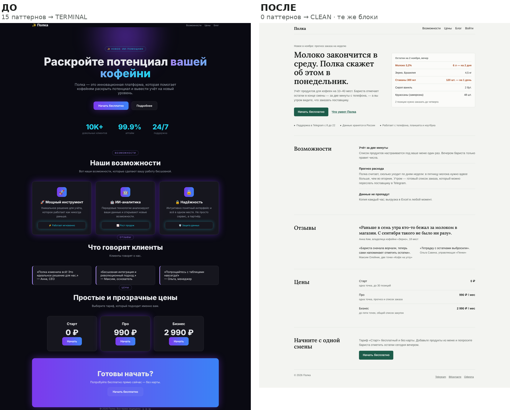
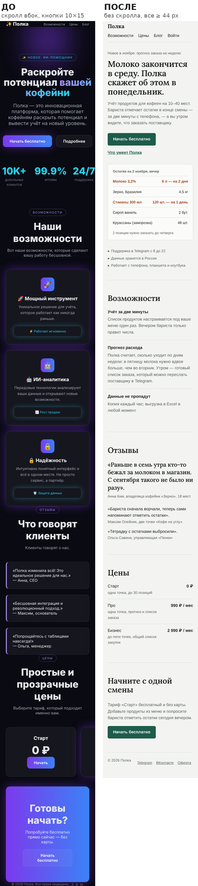

# Лендинг: до и после

Вымышленный сервис «Полка» — учёт продуктов для маленьких кофеен. `before.html` свёрстан так, как его выдаёт нейросеть без ограничений; `after.html` — **те же блоки в том же порядке и то же содержание**, вычищенные по скиллу. Продукт, имена и отзывы вымышленные — это демонстрация; на настоящем сайте нужны только настоящие отзывы.





## Что нашёл `webslop.py`

Полные отчёты — `audit-before.txt` и `audit-after.txt`, скриншоты на 390/768/1440 px — в `shots/`.

| | до | после |
|---|---|---|
| Визуальные паттерны | **15 → TERMINAL** | **0 → CLEAN** |
| Шрифты | Inter / Inter | Liberation Sans / Lora |
| Горизонтальный скролл | +534 px на 390, +156 px на 768 (таблица цен шириной 900 px) | нет |
| Зоны нажатия на 390 px | 6 из 12 меньше 44 px, ссылки меню и соцсетей 10×15 px | все 10 ≥ 44 px |
| Штампы в тексте | 14 видов: «раскройте потенциал», «на новый уровень», «бесшовный», «инновационный», «не просто …, а», «попрощайтесь с» … | нет |
| Типовые кнопки | 7 («Начать», «Подробнее») | нет |

Паттерны «до»: стекло на 11 блоках, фиолетово-синие градиенты, тёмная тема со свечением, градиентный текст, метрики «10K+ / 99.9% / 24/7», одинаковые сетки карточек, карточки в карточках, всё по центру, все кнопки одинаково главные, пилюли-надзаголовки, эмодзи вместо иконок, цветная полоса слева у отзывов, пружинящая анимация.

## Блок за блоком

| блок | до | после |
|---|---|---|
| Меню | эмодзи в логотипе, ссылки 16 px высотой | те же пункты, зоны нажатия от 44 px |
| Новость | пилюля «✨ НОВОЕ: ИИ-ПОМОЩНИК» капсом | строка «Новое в ноябре: прогноз заказа на неделю» |
| Первый экран | «Раскройте потенциал *вашей кофейни*» градиентом, подзаголовок пересказывает заголовок, «Начать бесплатно» + «Подробнее» | конкретное обещание «Молоко закончится в среду…», кому и как это работает, та же главная кнопка + текстовая ссылка, настоящий экран продукта |
| Метрики | «10K+ / 99.9% / 24/7» неоном — не подтверждены | проверяемые факты обычным текстом: поддержка, где хранятся данные, на чём работает |
| Возможности | три одинаковые карточки с эмодзи и иконкой в градиентном квадрате, «Мощный инструмент / ИИ-аналитика / Надёжность», вложенные плашки со свечением | те же три возможности строками разной длины, по делу: учёт за две минуты, прогноз расхода, копии и выгрузка |
| Отзывы | «Полка изменила всё!», «— Анна, CEO», цветная полоса слева | один главный отзыв и два коротких, с конкретикой, кто и где |
| Цены | три карточки фиксированной ширины 900 px — скролл вбок на телефоне | те же «Старт 0 ₽ / Про 990 ₽ / Бизнес 2 990 ₽» строками, с тем, что входит |
| Призыв | градиентная плашка «Готовы начать?» | «Начните с одной смены» — что именно сделать сегодня, та же кнопка |
| Подвал | иконки соцсетей 10×15 px | подписанные ссылки от 44 px |

Сквозные правки: палитра — 8 токенов с ролями (фон, карточка, текст, приглушённый текст, линии, акцент и текст на акценте — только для главной кнопки и ссылок, предупреждение — только для нехватки на складе); антиква для заголовков, гротеск для текста; линии вместо теней и стекла; выравнивание по левому краю.

`after.html` — не шаблон для копирования: антиква + тёплый акцент близки ко «второй волне» штампов. Здесь они привязаны к продукту (кофейня, предупреждения о нехватке), но в другом проекте это будет просто следующий дефолт.

Проверить самому:

```bash
python3 scripts/webslop.py audit examples/web/before.html --out /tmp/before
python3 scripts/webslop.py scan examples/web/
```
